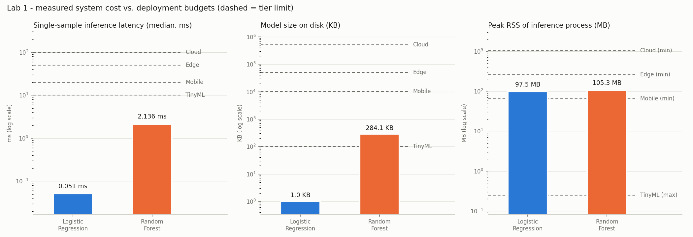

# Lab 1 - Environment and first system measurements

**Course:** Machine Learning (CYI5SE039CY), Group 11  
**Reading:** Reddi, *Introduction to Machine Learning Systems* - Ch. 1 §§1.4-1.6, Ch. 2 §§2.2-2.5 and §§2.8-2.9, Ch. 12 §§12.4 and 12.7

## 1. Goal

Set up a reproducible, pinned Python environment and measure what two classic baselines cost as *systems*, not only how accurate they are: training time, single-sample inference latency, model size and peak memory. Then use these measurements to decide on which deployment tier (Cloud, Edge, Mobile, TinyML) each model could realistically run.

## 2. Method

**Environment.** Python 3.11.8 in an isolated `.venv`, packages installed from the pinned `requirements.txt`. `src/print_versions.py` prints the Python version and the installed version of every pinned package, compares each with its pin, and its output is saved to `results/versions.txt`. The environment matches the required stack exactly: Python 3.11.8 and all 25 pinned packages report `OK` in `results/versions.txt`.

**Hardware.** Intel64 Family 6 Model 141 Stepping 1, GenuineIntel, 12 logical CPUs, 15.73 GB RAM, Windows 10 (AMD64). All numbers below are specific to this machine.

**Data.** Breast Cancer Wisconsin (Diagnostic), loaded with `load_breast_cancer(return_X_y=True)`: 569 samples, 30 numeric features, binary label. Split 70/30, stratified, `random_state=42` -> 398 train / 171 test samples; class counts (0 = malignant / 1 = benign): train 148 / 250, test 64 / 107. The dataset ships with scikit-learn, so nothing is downloaded and `data/` stays empty (it is git-ignored).

**Models.** Exactly as specified: `LogisticRegression(max_iter=1000, random_state=42)` and `RandomForestClassifier(n_estimators=100, random_state=42)`, default hyper-parameters otherwise, no feature scaling. Seeds: `random.seed(42)`, `np.random.seed(42)`, `torch.manual_seed(42)`, `torch.cuda.manual_seed_all(42)` (torch is seeded in every script except the memory-measurement processes, where importing torch would add hundreds of MB that these scikit-learn models never use).

**Measurement protocol.**

| Quantity | How it was measured |
|---|---|
| Test accuracy | `accuracy_score` on the 30 % test split, 4 decimals -> `results/baseline_accuracy.csv` |
| Training time | `time.perf_counter()` around `fit()` on a fresh model; 1 warm-up run discarded, then 5 runs; **median** reported |
| Inference latency | `predict()` on one test sample (shape 1x30); 1 warm-up, then 100 runs; **median** (and p95) reported |
| Model size | `joblib.dump` of each fitted model (`results/model_<name>.joblib`; both models together in `results/model.joblib`); file size in bytes and KB (1 KB = 1024 B) |
| Peak memory | Each model/phase in a **fresh Python process**. Tools: `memory_profiler`, `psutil` (`memory_profiler.memory_usage(max_usage=True)` at 1 ms and a `psutil.Process().memory_info().rss` sampler at 0.5 ms). Training = one `fit()`; inference = `joblib.load()` + 101 single-sample predictions. The higher reading of the tools is used |

Memory is reported two ways: **peak RSS** (the whole process: interpreter + NumPy/SciPy/scikit-learn + data + model - what a device really has to provide) and **delta** (peak minus the RSS just before the measured work - the extra memory the training or inference step itself adds).

## 3. Results

### 3.1 Accuracy and system cost

| Metric | Logistic Regression | Random Forest (100 trees) |
|---|---:|---:|
| Test accuracy | 0.9415 | 0.9357 |
| Training time, median of 5 (ms) | 231.03 | 107.83 |
| Inference latency, 1 sample, median of 100 (ms) | 0.0513 | 2.1361 |
| Inference latency, p95 (ms) | 0.0628 | 2.7812 |
| Model size (joblib) | 1,055 B (1.03 KB) | 290,889 B (284.07 KB) |
| Peak RSS during training (MB) | 105.1 | 104.9 |
| Training delta (MB) | 11.92 | 11.92 |
| Peak RSS during inference (MB) | 97.5 | 105.3 |
| Inference delta (MB) | 3.73 | 12.02 |

`results/model.joblib` (written with `joblib.dump`, both fitted models in one file): 291,674 B (284.84 KB). Per-model sizes in the table come from the individual dumps `results/model_logistic_regression.joblib` and `results/model_random_forest.joblib`.

*Observation:* on this machine Logistic Regression takes longer to train (231 ms) than the 100-tree Random Forest (108 ms). The reason is the unscaled data: lbfgs never converges and runs all 1000 iterations (see the note below), while the forest builds shallow trees quickly. The simpler model is not automatically the cheaper one to train - it has to be measured.

*Note:* with the prescribed `max_iter=1000` and unscaled features, the lbfgs solver of Logistic Regression stops at the iteration limit and scikit-learn raises a `ConvergenceWarning`. The model was kept exactly as specified; its accuracy is still 0.9415. Standardising the features would let it converge in far fewer iterations (and likely train faster) - a fix for later labs, not a change to this baseline.

*Figure 1 - Measured latency, model size and inference-process memory (log scale). Dashed lines are the tier limits from the lab manual.*

Raw data: `results/timing_raw.json` (every individual run), `results/memory.csv` (per tool), `results/measurements.csv` (the table above).

### 3.2 Resource budget table

| Tier | Memory budget | Latency budget | Size budget |
|---|---|---|---|
| Cloud | >= 1 GB | <= 100 ms | <= 500 MB |
| Edge | 256-1024 MB | <= 50 ms | <= 50 MB |
| Mobile | 64-256 MB | <= 20 ms | <= 10 MB |
| TinyML | <= 256 KB | <= 10 ms | <= 100 KB |

Decision rule: latency and size must be within the limit. The memory budget is the RAM a device of that tier has, compared with the **peak RSS of the inference process**; for Edge and Mobile, *Yes* = fits even the smallest device of the range (peak <= lower bound), *Partly* = fits only the larger devices (lower < peak <= upper bound).

| Model | Tier | Memory | Latency | Size | **Can run?** |
|---|---|:---:|:---:|:---:|---|
| Logistic Regression | Cloud | Yes | Yes | Yes | **Yes** |
| Logistic Regression | Edge | Yes | Yes | Yes | **Yes** |
| Logistic Regression | Mobile | Partly | Yes | Yes | **Partly (larger devices only)** |
| Logistic Regression | TinyML | No | Yes | Yes | **No** |
| Random Forest (100 trees) | Cloud | Yes | Yes | Yes | **Yes** |
| Random Forest (100 trees) | Edge | Yes | Yes | Yes | **Yes** |
| Random Forest (100 trees) | Mobile | Partly | Yes | Yes | **Partly (larger devices only)** |
| Random Forest (100 trees) | TinyML | No | Yes | No | **No** |

## 4. Deployment-fit argument

**Logistic Regression.** 
Fits **Cloud, Edge** without restriction: median latency 0.051 ms, model 1.0 KB and an inference process of 97 MB are all inside those budgets with a large margin. **Mobile**: latency and size pass, but the 97 MB Python process is above the 64 MB lower bound, so it runs only on the larger devices of that range. Almost all of that memory is the Python runtime and libraries (baseline before the work), not the model (inference delta 3.7 MB). **Not TinyML** as built: a 97 MB process versus a 256 KB budget. The learned parameters themselves are small - 30 weights + 1 bias, about 124 B if exported as float32 C arrays (`results/model_footprint.csv`) - so a hand-ported C version would fit a microcontroller easily. That would be a different deployment artifact than the one measured here.

**Random Forest (100 trees).** 
Fits **Cloud, Edge** without restriction: median latency 2.136 ms, model 284.1 KB and an inference process of 105 MB are all inside those budgets with a large margin. **Mobile**: latency and size pass, but the 105 MB Python process is above the 64 MB lower bound, so it runs only on the larger devices of that range. Almost all of that memory is the Python runtime and libraries (baseline before the work), not the model (inference delta 12.0 MB). **Not TinyML** as built: a 105 MB process versus a 256 KB budget; a 284 KB model file versus 100 KB. The learned parameters themselves are small - 100 trees, 3138 nodes, 1619 leaves, median depth 7, about 37,856 B if exported as float32 C arrays (`results/model_footprint.csv`) - so a hand-ported C version would fit a microcontroller easily. That would be a different deployment artifact than the one measured here.

**Recommendation.** Accuracy is practically the same (Logistic Regression ahead by 0.58 percentage points, i.e. 1 of 171 test samples), while Logistic Regression is about 42x faster per prediction and about 276x smaller on disk. For any constrained target (Edge, Mobile, and TinyML after porting) Logistic Regression is the better choice; the Random Forest offers no accuracy advantage that would pay for its extra cost.

## 5. Conclusions

1. **Accuracy alone does not separate these models; system cost does.** Test accuracy is 0.9415 vs 0.9357 - a difference of 1 test sample(s) out of 171. The system cost differs by orders of magnitude: the forest is about 42x slower per prediction and about 276x larger. On this task, Logistic Regression gives the better accuracy, but the cost difference is what decides deployment.

2. **For small models the runtime, not the model, dominates memory.** Both inference processes peak at roughly 97-105 MB, while the models are 1.0 KB and 284 KB. This is why neither fits TinyML and both are only *partly* fit for Mobile as Python programs: reaching those tiers needs a different runtime (e.g. ONNX Runtime / exported C code), not a smaller model.

3. **How you measure changes the answer.** A single timing run of a sub-millisecond call is dominated by noise and first-call effects, so warm-up plus the median of many runs is necessary (the RF latency p95 is 2.78 ms vs a median of 2.14 ms). Likewise, memory has to be measured in a fresh process per model and reported both as total peak and as delta; otherwise one model's allocations or the import cost get charged to the other.

## 6. Reproducibility

From the repository root, with the virtual environment active, run `python lab01/src/run_all.py`.

This regenerates every file in `lab01/results/` and this report. All randomness is seeded with 42; timings and memory depend on the machine and on background load, so small differences between runs are expected - the medians and the deployment decisions are stable.

| File | Content |
|---|---|
| `results/versions.txt` | Python and all package versions vs. pins |
| `results/baseline_accuracy.csv` | test accuracy (4 decimals) |
| `results/split_info.json` | split sizes and class balance |
| `results/hardware.json` | machine used for the measurements |
| `results/cost_time_size.csv` | training time, latency, model size |
| `results/timing_raw.json` | every individual timing run |
| `results/memory.csv / memory_raw.json` | peak memory per model, phase and tool |
| `results/measurements.csv` | combined measurement table |
| `results/deployment_fit.csv` | budget check per model and tier |
| `results/model_footprint.csv` | parameter count and C-export size estimate |
| `results/model.joblib, model_<name>.joblib` | saved models |
| `results/system_cost.png` | Figure 1 |
