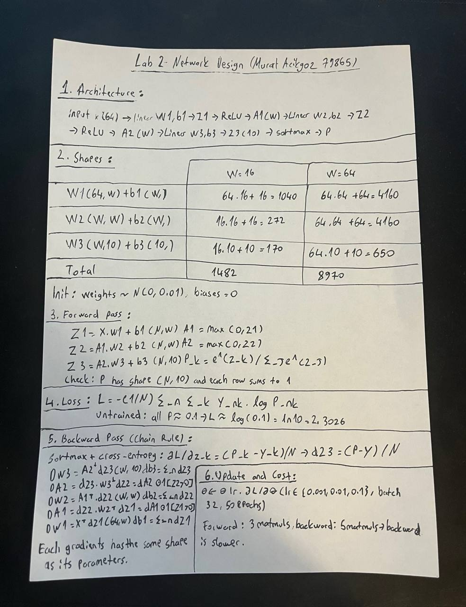
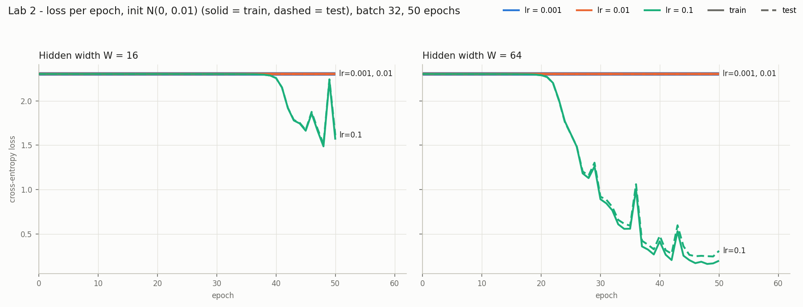
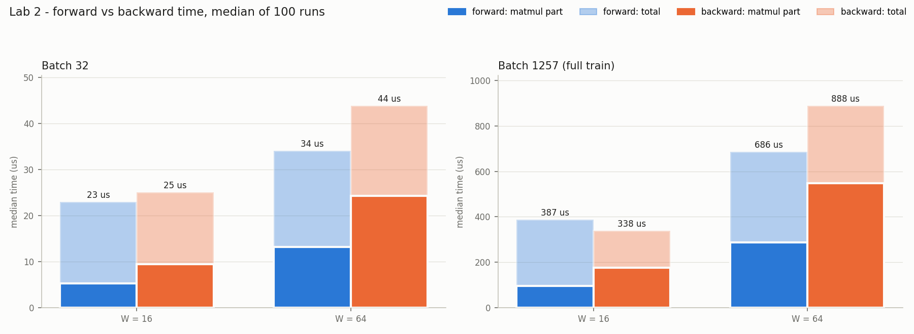

# Lab 2 - A neural network from scratch

**Course:** Machine Learning (CYI5SE039CY), Group 11  
**Reading:** Reddi, *Introduction to Machine Learning Systems*, Ch. 3 DL Primer - §3.4, §§3.5.1-3.5.5 and §3.6

## 1. Goal

Build a two-hidden-layer neural network in plain NumPy - no deep-learning framework - and verify every part of it: dimensionally correct parameters, a forward pass that outputs valid probabilities, a cross-entropy loss with the expected starting value, hand-derived gradients confirmed by numerical gradient checking, and a mini-batch training loop. Then compare learning rates and hidden widths, and measure where the time goes in one training step (forward vs. backward pass).

## 2. Method

**Environment.** Python 3.11.8 in the repository's pinned `.venv`; `src/print_versions.py` writes the Python and package versions to `results/versions.txt`. All 25 pinned packages report `OK`. Hardware: Intel64 Family 6 Model 141 Stepping 1, GenuineIntel, 12 logical CPUs, 15.73 GB RAM, Windows 10; NumPy 1.26.4. All computation is float64.

**Step 1 - data.** `load_digits` (8x8 grey-scale digits): 1797 samples x 64 features, 10 classes. Inputs are divided by 16, so every pixel lies in [0, 1]. Labels are one-hot encoded (train matrix (1257, 10), every row sums to 1: yes). Split 70/30, stratified, `random_state=42` -> 1257 train / 540 test samples (per-class counts: train [124, 127, 124, 128, 127, 127, 127, 125, 122, 126], test [54, 55, 53, 55, 54, 55, 54, 54, 52, 54]).

**Step 2 - network design.** Input 64 -> hidden W -> ReLU -> hidden W -> ReLU -> output 10 -> softmax, for W = 16 and W = 64. Weights are drawn from N(0, 0.01), implemented as mean 0 and standard deviation 0.01 (`np.random.normal(0, 0.01)`); biases start at 0. The script asserts that the created arrays have exactly these shapes.

| Layer | W = 16: weight / bias | params | W = 64: weight / bias | params | Activation |
|---|---|---:|---|---:|---|
| hidden 1 (64 -> 16 / 64 -> 64) | (64, 16) / (16,) | 1,040 | (64, 64) / (64,) | 4,160 | ReLU |
| hidden 2 (16 -> 16 / 64 -> 64) | (16, 16) / (16,) | 272 | (64, 64) / (64,) | 4,160 | ReLU |
| output (16 -> 10 / 64 -> 10) | (16, 10) / (10,) | 170 | (64, 10) / (10,) | 650 | softmax |
| **total** | | **1,482** | | **8,970** | |

The design was first done by hand on paper (shapes, forward equations and the gradient derivation):

*Figure 1 - Handwritten network design and gradient derivation.*

**Step 3 - forward pass** (N = batch size, layer by layer):

| Layer | Computation | Output shape |
|---|---|---|
| hidden 1 | `Z1 = X W1 + b1`, `A1 = ReLU(Z1)` | (N, W) |
| hidden 2 | `Z2 = A1 W2 + b2`, `A2 = ReLU(Z2)` | (N, W) |
| output | `Z3 = A2 W3 + b3`, `P = softmax(Z3)` | (N, 10) |

Softmax subtracts each row's maximum before `exp` so it cannot overflow. Checks: output shape (N, 10) and `|sum_k P[n,k] - 1| < 1e-6` for every row.

**Step 4 - loss.** Mean cross-entropy `L = -(1/N) sum_n sum_k Y[n,k] log P[n,k]`, computed from the logits with a stable log-softmax. Sanity check: with near-zero weights all 10 probabilities are about 0.1, so the untrained loss should be about ln(10) = 2.3026.

**Step 5 - gradients (chain rule).** Softmax and cross-entropy together give a simple output error; every other gradient follows from the chain rule through the matrix products and the ReLU masks:

| Gradient | Formula | Shape |
|---|---|---|
| output error | `dZ3 = (P - Y) / N` | (N, 10) |
| layer 3 | `dW3 = A2^T dZ3`, `db3 = sum_n dZ3` | (W, 10), (10,) |
| back to hidden 2 | `dA2 = dZ3 W3^T`, `dZ2 = dA2 * 1[Z2 > 0]` | (N, W) |
| layer 2 | `dW2 = A1^T dZ2`, `db2 = sum_n dZ2` | (W, W), (W,) |
| back to hidden 1 | `dA1 = dZ2 W2^T`, `dZ1 = dA1 * 1[Z1 > 0]` | (N, W) |
| layer 1 | `dW1 = X^T dZ1`, `db1 = sum_n dZ1` | (64, W), (W,) |

*Gradient check:* 10 weights are sampled at random (seed 42) from the entries of W1, W2 and W3 whose gradient on the check batch is not exactly zero (a weight attached to a pixel that is 0 in every check image - e.g. the image border - or to an inactive ReLU unit has gradient 0 in both methods and would test nothing). Each is nudged by +1e-5 and -1e-5 and the central-difference slope `(L(w+e) - L(w-e)) / 2e` is compared with the analytic gradient on a fixed batch of the first 32 training samples. Relative error = `|analytic - numerical| / max(|analytic|, |numerical|)` (0 when both are exactly 0). Pass: relative error < 1e-6 for at least 9 of 10 weights. The check is run on the trained networks (lr = 0.1, after 50 epochs), where gradients have realistic sizes, and - for transparency - also on the untrained N(0, 0.01) networks. As extra evidence every single parameter (weights and biases) is also checked and the vector relative error `||analytic - numerical|| / max(||analytic||, ||numerical||)` is reported.

**Step 6 - training.** Plain mini-batch SGD: the training set is reshuffled every epoch, batch size 32, 50 epochs, update `p <- p - lr * dp`. Grid: learning rates [0.001, 0.01, 0.1] x widths [16, 64] = 6 runs, each starting from seed 42. After every epoch the full train and test sets are evaluated and logged (`results/training_log.csv`). Because "N(0, 0.01)" is also often read as *variance* 0.01, the same grid was repeated as a supplementary experiment with standard deviation 0.1.

**Step 7 - timing.** Forward pass, loss and backward pass are timed separately with `time.perf_counter()`: 1 warm-up call, then 100 timed calls, **median** reported (p95 in the CSV). Batch sizes 32 (the training mini-batch) and 1257 (the whole training set). To link the time to matrix multiplication, the matmuls of each pass are also timed alone with exactly the same shapes, and the analytic FLOP count (2·m·k·n per matmul) is computed.

## 3. Results

### 3.1 Forward pass and initial loss (steps 3-4)

| W | Input | Output shape | max abs(row sum - 1) | Rows sum to 1 (< 1e-6) | Initial loss | ln(10) |
|---:|---|---|---:|:---:|---:|---:|
| 16 | batch of 32 (train) (32, 64) | (32, 10) | 2.220e-16 | yes | 2.3026 | 2.3026 |
| 16 | full train set (1257, 64) | (1257, 10) | 4.441e-16 | yes | 2.3026 | 2.3026 |
| 16 | full test set (540, 64) | (540, 10) | 2.220e-16 | yes | 2.3026 | 2.3026 |
| 64 | batch of 32 (train) (32, 64) | (32, 10) | 3.331e-16 | yes | 2.3026 | 2.3026 |
| 64 | full train set (1257, 64) | (1257, 10) | 3.331e-16 | yes | 2.3026 | 2.3026 |
| 64 | full test set (540, 64) | (540, 10) | 4.441e-16 | yes | 2.3026 | 2.3026 |

Every output has shape (batch, 10) and every row sums to 1 within 4.4e-16 (limit 1e-6). The untrained loss differs from ln(10) by at most 3.8e-05: with weights of size 0.01 the logits are almost zero, so the softmax is almost uniform.

### 3.2 Gradient check (step 5)

| Network | W | Weights below 1e-6 | Required | Criterion | Max rel. error | Max abs. error | All-parameter vector rel. error (params) |
|---|---:|---:|---:|:---:|---:|---:|---:|
| trained (lr 0.1) | 16 | 10/10 | 9 | **PASS** | 1.03e-07 | 1.44e-11 | 6.82e-11 (1,482) |
| trained (lr 0.1) | 64 | 10/10 | 9 | **PASS** | 3.26e-07 | 3.57e-12 | 2.49e-10 (8,970) |
| untrained N(0, 0.01) | 16 | 6/10 | 9 | not met | 6.97e-03 | 2.46e-07 | 1.00e-03 (1,482) |
| untrained N(0, 0.01) | 64 | 7/10 | 9 | not met | 1.69e-05 | 2.98e-11 | 2.76e-04 (8,970) |

Sampled weights of the trained networks:

| W | Weight | Analytic | Numerical | Rel. error | < 1e-6 |
|---:|---|---:|---:|---:|:---:|
| 16 | W1(9, 0) | 1.245177e-01 | 1.245177e-01 | 2.8e-11 | yes |
| 16 | W1(9, 2) | -2.610236e-02 | -2.610236e-02 | 3.0e-10 | yes |
| 16 | W1(9, 11) | -4.217444e-02 | -4.217444e-02 | 6.6e-12 | yes |
| 16 | W1(19, 13) | -1.077832e-01 | -1.077832e-01 | 3.6e-11 | yes |
| 16 | W1(43, 8) | -8.576781e-02 | -8.576781e-02 | 4.0e-12 | yes |
| 16 | W1(43, 15) | -1.612079e-05 | -1.612079e-05 | 4.4e-10 | yes |
| 16 | W2(0, 2) | -4.622403e-01 | -4.622403e-01 | 3.1e-11 | yes |
| 16 | W2(3, 1) | -6.110522e-05 | -6.110521e-05 | 1.0e-07 | yes |
| 16 | W2(8, 13) | 5.177123e-01 | 5.177123e-01 | 2.3e-11 | yes |
| 16 | W3(1, 2) | -7.883617e-02 | -7.883617e-02 | 6.6e-11 | yes |
| 64 | W1(12, 38) | -4.654612e-05 | -4.654612e-05 | 7.2e-08 | yes |
| 64 | W1(12, 62) | 1.265380e-02 | 1.265380e-02 | 2.2e-10 | yes |
| 64 | W1(13, 37) | 2.857023e-02 | 2.857023e-02 | 4.6e-11 | yes |
| 64 | W1(30, 30) | 6.270052e-06 | 6.270050e-06 | 3.3e-07 | yes |
| 64 | W2(2, 21) | -3.020871e-06 | -3.020871e-06 | 1.5e-07 | yes |
| 64 | W2(2, 61) | 7.001459e-05 | 7.001459e-05 | 5.1e-08 | yes |
| 64 | W2(30, 62) | -2.950889e-05 | -2.950889e-05 | 7.4e-08 | yes |
| 64 | W2(36, 1) | 4.561252e-03 | 4.561252e-03 | 4.4e-10 | yes |
| 64 | W2(45, 50) | -2.748075e-03 | -2.748075e-03 | 3.8e-10 | yes |
| 64 | W2(55, 47) | 3.389652e-03 | 3.389652e-03 | 8.1e-10 | yes |

**The analytic gradients pass the check for both widths** (10/10 for W = 16, 10/10 for W = 64). When a weight has a normal-sized gradient the two methods agree to many significant digits (largest relative error among passing weights: 3.3e-07). Weights excluded from sampling because their gradient is exactly 0: 493 of 1,440 (W = 16) and 2,081 of 8,832 (W = 64). The all-parameter check covers every weight and bias and gives a vector relative error of 6.82e-11 (W = 16) and 2.49e-10 (W = 64).

On the **untrained** network the same procedure gives 6/10 (W = 16) and 7/10 (W = 64), below the 9-of-10 rule. Every miss was classified automatically (`failure_reason` in `results/grad_check.csv`), and none of them points to a wrong formula: **6** are gradients of only about 1e-5 to 1e-7. `L(w+e)` and `L(w-e)` are both about 2.3026 and differ only in their last digits; float64 resolves that difference to about 1e-16, so the numerical slope carries an absolute error of about 1e-11 (measured 2e-12 to 3e-11) - tiny in absolute terms, but large relative to a gradient of 1e-6. **1** crossed a ReLU kink: with N(0, 0.01) weights the second-layer pre-activations are typically only 1e-3 to 1e-4 and some are far smaller, so the +/-1e-5 nudge itself switched a hidden unit on or off between the two loss evaluations, where the loss has no derivative and the finite difference is invalid. Both effects disappear once the weights and gradients have realistic sizes, which is why the trained-network check passes. Lesson: a relative-error gradient check is only informative when the gradient is far above the float64 noise floor and the nudge does not cross a kink.

### 3.3 Training: learning rate x width (step 6)

| W | lr | Final train loss | Final test loss | Final train acc. | **Final test acc.** | First epoch with train loss < 2.2 | Train time (s) |
|---:|---:|---:|---:|---:|---:|---:|---:|
| 16 | 0.001 | 2.3025 | 2.3025 | 0.1018 | **0.1019** | never | 0.14 |
| 16 | 0.01 | 2.3025 | 2.3025 | 0.1018 | **0.1019** | never | 0.13 |
| 16 | 0.1 | 1.5625 | 1.6117 | 0.4956 | **0.5037** | 41 | 0.13 |
| 64 | 0.001 | 2.3025 | 2.3025 | 0.1018 | **0.1019** | never | 0.20 |
| 64 | 0.01 | 2.3023 | 2.3023 | 0.1018 | **0.1019** | never | 0.20 |
| 64 | 0.1 | 0.1983 | 0.3096 | 0.9340 | **0.9056** | 23 | 0.21 |

*Figure 2 - Train (solid) and test (dashed) cross-entropy per epoch for all six runs (`results/loss_curves.png`). Accuracy curves: `results/accuracy_curves.png`.*

**Analysis.** The best run is W = 64, lr = 0.1 with test accuracy **0.9056**. 4 of the 6 runs (W=16/lr=0.001, W=16/lr=0.01, W=64/lr=0.001, W=64/lr=0.01) never leave the starting loss of about ln(10) and end at chance-level accuracy (about 0.10, the network predicts one class). The cause is the very small initialisation: with weights of size 0.01 the activations shrink by roughly a factor of 0.01·sqrt(fan-in) per layer, and the gradient that reaches W1 is multiplied by both W2 and W3, so it is tiny. A small learning rate turns this tiny gradient into an even smaller update, and 50 epochs are not enough to break out of the plateau. Only the largest learning rate escapes the plateau (W = 16: epoch 41; W = 64: epoch 23), and then the loss drops quickly, with some spikes typical of plain SGD with a large step. The wider network escapes earlier and ends much better: more hidden units give more paths for the signal and a larger gradient, and more capacity. Train and test curves stay close, so there is no strong overfitting within 50 epochs.

**Supplementary - initial standard deviation 0.1** (`results/final_accuracy_init_std0.1.csv`, `results/loss_curves_init_std0.1.png`):

| W | lr = 0.001 | lr = 0.01 | lr = 0.1 |
|---:|---:|---:|---:|
| 16 | 0.1833 | 0.6315 | 0.9556 |
| 64 | 0.3593 | 0.9204 | 0.9667 |

With ten times larger initial weights the plateau disappears for most runs and the ranking becomes the textbook one: larger learning rate and larger width learn faster, best test accuracy 0.9667 (W = 64, lr = 0.1). This confirms that the weak results of the small learning rates in the main grid come from the initialisation scale, not from the gradients or the training loop.

### 3.4 Forward vs. backward timing (step 7)

| W | Batch | Forward (us) | Loss (us) | Backward (us) | Backward / forward | Matmul share fwd / bwd | Matmul MFLOP fwd / bwd | FLOP ratio bwd/fwd |
|---:|---|---:|---:|---:|---:|---:|---:|---:|
| 16 | 32 | 23.00 | 12.25 | 25.00 | **1.09** | 23% / 38% | 0.092 / 0.119 | 1.29 |
| 16 | 1257 (full train) | 387.00 | 152.30 | 338.00 | **0.87** | 25% / 52% | 3.620 / 4.666 | 1.29 |
| 64 | 32 | 34.00 | 12.40 | 43.80 | **1.29** | 39% / 55% | 0.565 / 0.868 | 1.54 |
| 64 | 1257 (full train) | 686.40 | 155.25 | 888.25 | **1.29** | 42% / 62% | 22.204 / 34.110 | 1.54 |

*Figure 3 - Median forward and backward time; the dark part of each bar is the time of the pass's matrix multiplications alone (`results/timing_breakdown.png`, raw runs in `results/timing_raw.json`).*

**The backward pass is the slower one in 3 of 4 configurations** (backward/forward ratio 0.87 to 1.29). The link is matrix multiplication. The forward pass needs 3 matmuls (`X W1`, `A1 W2`, `A2 W3`); the backward pass needs 5, because every layer must produce a weight gradient (`A^T dZ`) and - except the first layer - also pass the error back (`dZ W^T`). Counting 2·m·k·n FLOPs per matmul, backward does 1.29x the work of forward for W = 16 and 1.54x for W = 64 (the W x W layer appears twice in backward). Timing the matmuls alone confirms it: the backward matmuls took 1.77x to 1.90x as long as the forward matmuls in every configuration. In the largest configuration (W = 64, batch 1257) the matmuls are 62% of the backward time and the measured ratio is 1.29 (FLOP ratio 1.54). The exception is W = 16 with batch 1257 (ratio 0.87): its forward pass took 387 us, but only 96 us of that were matmuls. With just 16 hidden units the matrix products are so small that the element-wise work - the softmax (`exp`, row maximum and division over N x 10 values), the bias additions and the ReLUs - costs more than the matmuls, and that work sits mostly in the forward pass. For the small batch of 32, each NumPy call also has a fixed overhead of a few microseconds regardless of size, which pulls the two passes closer together. So the backward pass is more expensive exactly when matrix multiplication dominates the step - wider layers and larger batches - and that is the regime where training cost matters.

## 4. Conclusions

1. **The hand-derived backpropagation is correct.** The numerical check passes on the trained networks (10/10 (W = 16) and 10/10 (W = 64)) and the all-parameter relative error is about 1e-10. The untrained check also showed that a finite-difference test has a precision floor: with tiny N(0, 0.01) gradients the relative error is dominated by float64 rounding (and occasionally a ReLU kink), so a gradient check must be read together with the gradient's size.

2. **Initialisation scale and learning rate decide whether the network learns, width decides how well.** With N(0, 0.01) initial weights only lr = 0.1 learned at all (best test accuracy 0.9056 with W = 64); the smaller learning rates stayed at ln(10) and chance accuracy for all 50 epochs. The wider network escaped the plateau earlier and reached a much higher accuracy. With standard deviation 0.1 all settings improve (best 0.9667), so the small-weight start, not the model, limited the main runs.

3. **Matrix multiplication makes the backward pass the expensive half - when matmuls dominate the step.** Backward needs 5 matmuls against 3 in forward (1.29x to 1.54x the FLOPs), and the backward matmuls alone took 1.77-1.90x the forward ones. The whole backward pass was slower in 3 of 4 configurations; for W = 16 with batch 1257 the forward softmax and other element-wise work outweighed the tiny matmuls (ratio 0.87). Timing has to be measured per component - the FLOP count alone does not predict it for small layers.

## 5. Reproducibility

From the repository root with the virtual environment active, run `python lab02/src/run_all.py`. It regenerates every file in `lab02/results/` and this report (the handwritten page photo is kept). All randomness uses seed 42; timings depend on the machine, so small differences between runs are expected.

| File | Content |
|---|---|
| `results/versions.txt` | Python and package versions vs. pins |
| `results/hardware.json` | machine used |
| `results/data_checks.json` | step 1: data shapes, scaling, split |
| `results/network_design.csv` | step 2: parameter shapes and counts |
| `results/network_design_paper.jpg` | step 2: handwritten design page |
| `results/forward_checks.csv` | steps 3-4: output shape, row sums, initial loss |
| `results/grad_check.csv / grad_check_summary.csv` | step 5: per-weight and summary gradient check |
| `results/training_log.csv` | step 6: per-epoch train/test loss and accuracy for all runs |
| `results/final_accuracy.csv` | step 6: final accuracy per run |
| `results/loss_curves.png / accuracy_curves.png` | step 6: curves |
| `results/params_W<width>_lr<lr>.npz` | trained parameters of each run |
| `results/*_init_std0.1.*` | supplementary runs with initial std 0.1 |
| `results/timing.csv / timing_raw.json / timing_breakdown.png` | step 7: timing breakdown |
