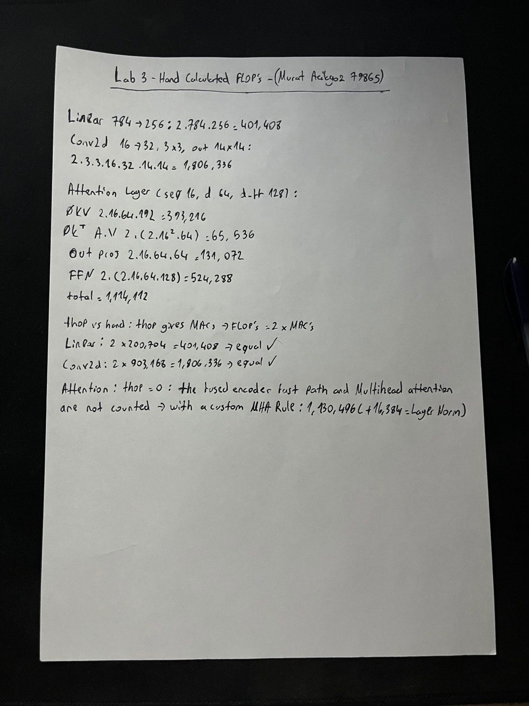
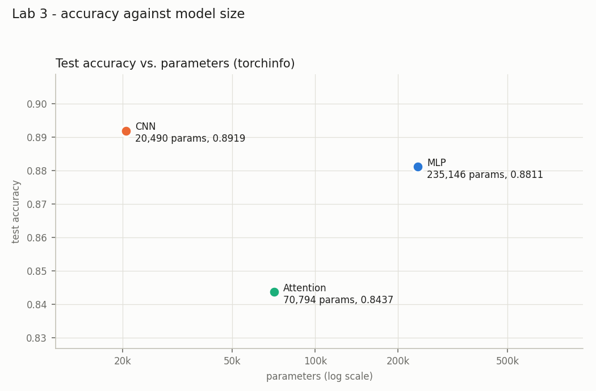
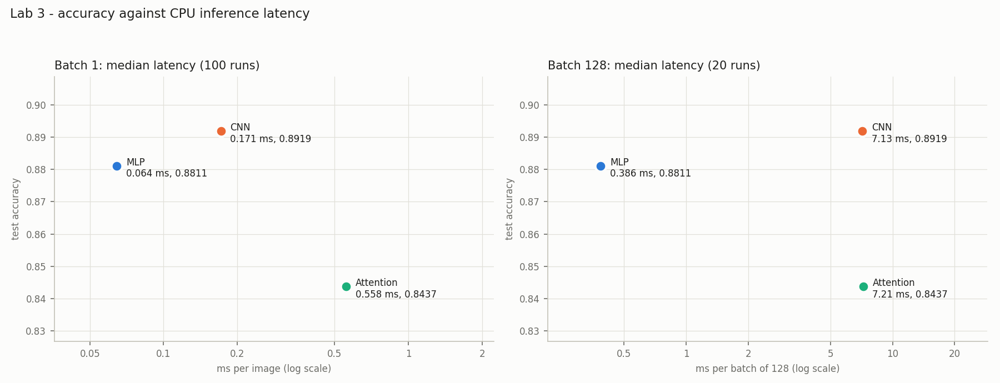

# Lab 3 - Architectures and their costs

**Course:** Machine Learning (CYI5SE039CY), Group 11  
**Reading:** Reddi, *Introduction to Machine Learning Systems*, Ch. 4 DNN Architectures - §4.2 MLPs, §4.3 CNNs, §4.5 Attention, §4.6 Architectural Building Blocks, §4.7 System-Level Building Blocks

## 1. Goal

Implement an MLP, a CNN and a small attention (Transformer) model for Fashion-MNIST in PyTorch, and compare them not only by accuracy but by what they cost: parameters, FLOPs (calculated by hand and measured with a profiler), and CPU inference latency at batch 1 and batch 128. Then use the access patterns of Ch. 4.6-4.7 to explain which architecture gives the most accuracy per unit of cost.

## 2. Method

**Environment.** Python 3.11.8 in the repository's pinned `.venv` (all 25 pins `OK` in `results/versions.txt`); PyTorch 2.3.1+cpu. Everything runs on the CPU (Intel64 Family 6 Model 141 Stepping 1, GenuineIntel, 12 logical CPUs, PyTorch using 6 threads, 15.73 GB RAM, Windows 10). Seeds: `random`, `numpy`, `torch` and `torch.cuda` = 42.

**Step 1 - data.** `torchvision.datasets.FashionMNIST` with `ToTensor()` and `Normalize((0.2860,), (0.3530,))`. The official 60k training set is split with a seeded `random_split` into 55,000 training and 5,000 validation images; the official 10k test set is used only for the final accuracy. Batch size 128. The data is downloaded to `data/`, which is git-ignored.

**Step 2 - models** (layer sizes exactly as specified):

| Model | Architecture | Parameters (torchinfo) | In 100k-150k target? |
|---|---|---:|:---:|
| MLP | Flatten 784 -> Linear 256 -> ReLU -> Linear 128 -> ReLU -> Linear 10 | 235,146 | no |
| CNN | Conv2d(1,16,3,p=1) -> ReLU -> MaxPool2 -> Conv2d(16,32,3,p=1) -> ReLU -> MaxPool2 -> Flatten -> Linear(1568,10) | 20,490 | no |
| Attention | 16 patches of 7x7 -> Linear 49->64 -> 2 x TransformerEncoderLayer (d_model 64, 4 heads, d_ff 128) -> mean pool -> Linear 64->10 | 70,794 | no |

The manual gives both a size target (100k-150k parameters) and exact layer sizes, and the exact layers do not land in the target: MLP 235,146, CNN 20,490, Attention 70,794. I kept the specified layers unchanged, because changing widths would change the architectures being compared. The sizes therefore differ by about 11x, which is part of the trade-off analysis below. The attention model has no positional encoding because none is specified, so after mean pooling it does not know where each patch was in the image.

**Step 3 - cost.** *Parameters:* `torchinfo.summary` with a 1x1x28x28 input (full tables in `results/torchinfo_<model>.txt`), checked against a hand count. *FLOPs (per image):* hand calculation with the Ch. 4 formulas - Linear `2 x in x out`, Conv2d `2 x K x K x C_in x C_out x H_out x W_out`, attention `2 x seq x d x 3d` (QKV) + `2 x seq^2 x d` (scores) + `2 x seq^2 x d` (weighted sum) + `2 x seq x d x d` (output projection) + the feed-forward Linears; only the multiply-adds of matrix products are counted. These are compared with `thop.profile`, which reports multiply-accumulates (MACs), so thop FLOPs = 2 x MACs. *Latency:* trained models, `eval()` + `torch.no_grad()`, real test images, 3 warm-up calls, then the median of 100 runs at batch 1 and of 20 runs at batch 128 (`time.perf_counter`).

**Step 4 - training.** Each model from seed 42, 5 epochs, Adam, learning rate 0.001, batch 128, cross-entropy loss; train and validation metrics are logged every epoch (`results/training_log.csv`) and the test set is evaluated once at the end.

## 3. Results

### 3.1 Parameters

| Model | torchinfo total | trainable | hand count | sum of `numel()` |
|---|---:|---:|---:|---:|
| MLP | 235,146 | 235,146 | 235,146 | 235,146 |
| CNN | 20,490 | 20,490 | 20,490 | 20,490 |
| Attention | 70,794 | 70,794 | 70,794 | 70,794 |

The hand counts match torchinfo exactly for all three models. Where the parameters sit:

| Model | Layer | Parameters | FLOPs per image (hand) |
|---|---|---:|---:|
| MLP | Linear 784->256 | 200,960 | 401,408 |
| MLP | Linear 256->128 | 32,896 | 65,536 |
| MLP | Linear 128->10 | 1,290 | 2,560 |
| CNN | Conv2d 1->16, 3x3, out 28x28 | 160 | 225,792 |
| CNN | Conv2d 16->32, 3x3, out 14x14 | 4,640 | 1,806,336 |
| CNN | Linear 1568->10 | 15,690 | 31,360 |
| Attention | Patch projection Linear 49->64 (x16 tokens) | 3,200 | 100,352 |
| Attention | Transformer encoder layer 1 | 33,472 | 1,114,112 |
| Attention | Transformer encoder layer 2 | 33,472 | 1,114,112 |
| Attention | Linear 64->10 (after mean pool) | 650 | 1,280 |

The MLP's first layer alone holds 200,960 of its 235,146 parameters, because every one of the 784 pixels is connected to every hidden unit. The CNN's convolutions hold only 4,800 parameters - a 3x3 kernel is shared across all positions - and most of its parameters are in the final Linear layer.

### 3.2 FLOPs: hand calculation vs. thop (step 3)

The hand calculation was first done on paper:

*Figure 1 - Handwritten parameter and FLOP calculation.*

**One layer of each type** (FLOPs for one image):

| Type | Layer | Hand formula | Hand FLOPs | thop default (2 x MACs) | Difference | thop, no fast path | thop, no fast path + MHA rule |
|---|---|---|---:|---:|---:|---:|---:|
| Linear | Linear 784->256 | `2 x 784 x 256` | 401,408 | 401,408 | 0 | - | - |
| Conv2d | Conv2d 16->32, 3x3, out 14x14 | `2 x 3 x 3 x 16 x 32 x 14 x 14` | 1,806,336 | 1,806,336 | 0 | - | - |
| Attention | Transformer encoder layer 1 (seq 16, d 64, d_ff 128) | `QKV + QK^T + AV + out-proj + FFN` | 1,114,112 | 0 | -1,114,112 | 540,672 | 1,130,496 |

Attention layer by hand (seq = 16 tokens, d = 64, d_ff = 128): QKV projections 2·16·64·192 = 393,216; scores QK^T 2·16²·64 = 32,768; weighted sum AV 2·16²·64 = 32,768; output projection 2·16·64·64 = 131,072; feed-forward 2·16·64·128 + 2·16·128·64 = 524,288; total 1,114,112 FLOPs. Because the sequence is short (16 tokens), the seq² terms are only 6% of the layer; the projections dominate.

**Whole models:**

| Model | Hand FLOPs | thop default (2 x MACs) | thop / hand | torchinfo mult-adds x 2 |
|---|---:|---:|---:|---:|
| MLP | 469,504 | 469,504 | 1.000 | 470,292 |
| CNN | 2,063,488 | 2,063,488 | 1.000 | 2,101,140 |
| Attention | 2,329,856 | 101,632 | 0.044 | 7,700 |

| Attention model, thop variant | FLOPs (2 x MACs) | / hand |
|---|---:|---:|
| default (eval mode, PyTorch encoder fast path) | 101,632 | 0.044 |
| regular per-module path (fast path disabled) | 1,182,976 | 0.508 |
| + custom thop rule for `nn.MultiheadAttention` | 2,362,624 | 1.014 |

**Explaining the gaps.** (1) thop counts multiply-accumulates; one MAC is two FLOPs, so every thop number is doubled before comparing. (2) For the Linear layer thop and the hand formula agree exactly: both count in x out multiply-adds and ignore the bias. (3) For the convolution thop also agrees exactly: this thop version counts K x K x C_in multiply-adds per output value and, like the Ch. 4 formula, ignores the bias. (4) For the attention model the default thop count is only 4% of the hand count. In `eval()` mode PyTorch runs each `TransformerEncoderLayer` as one fused kernel (the encoder *fast path*), so the forward hooks that thop puts on `Linear` layers never fire and the encoder is invisible; only the patch projection and the head are counted. With the fast path disabled thop sees the feed-forward Linears and reaches 51%, but it still misses the attention block itself: thop has no rule for `nn.MultiheadAttention`, and that module multiplies by its weight tensors directly instead of calling `Linear` sub-modules, so the QKV projections, QK^T, AV and the output projection go uncounted. Adding a custom thop rule for `nn.MultiheadAttention` closes the gap to 1.014 x the hand count. The remaining +32,768 FLOPs are exactly the LayerNorm operations that thop counts (32,768 FLOPs for the four LayerNorms) and the Ch. 4 formula leaves out. torchinfo's mult-adds estimate behaves similarly: MLP 1.002 x hand, CNN 1.018 x hand, Attention 0.003 x hand - it adds the bias terms (for the MLP its mult-adds equal the parameter count) and, like thop, cannot see inside the fused encoder. Lesson: a profiler only counts the operations it has rules for and actually observes; fused kernels and unsupported modules make it under-count, so a hand calculation is the reference.

### 3.3 Inference latency (step 3)

| Model | Batch 1: median ms (100 runs) | Batch 128: median ms (20 runs) | Batch 128: ms per image | Speed-up per image from batching | Images/s at batch 128 |
|---|---:|---:|---:|---:|---:|
| MLP | 0.0644 | 0.386 | 0.00301 | 21.4x | 331,649 |
| CNN | 0.1714 | 7.131 | 0.05571 | 3.1x | 17,950 |
| Attention | 0.5581 | 7.207 | 0.05631 | 9.9x | 17,760 |

Raw runs: `results/latency_raw.json` (p95/min/max in `results/latency.csv`).

### 3.4 Training and test accuracy (step 4)

| Model | val acc ep 1 | val acc ep 2 | val acc ep 3 | val acc ep 4 | val acc ep 5 | **Test accuracy** | Train time (s) |
|---|---:|---:|---:|---:|---:|---:|---:|
| MLP | 0.8428 | 0.8590 | 0.8722 | 0.8772 | 0.8830 | **0.8811** | 47.4 |
| CNN | 0.8480 | 0.8700 | 0.8878 | 0.8854 | 0.8982 | **0.8919** | 74.1 |
| Attention | 0.7960 | 0.8052 | 0.8348 | 0.8396 | 0.8512 | **0.8437** | 89.0 |

### 3.5 Trade-offs (step 5)

*Figure 2 - Test accuracy against parameter count (`results/accuracy_vs_params.png`).*

*Figure 3 - Test accuracy against median CPU latency at batch 1 and batch 128 (`results/accuracy_vs_latency.png`).*

| Model | Test acc. | Params | FLOPs / image | FLOPs per parameter | Latency b1 (ms) | Latency b128 (ms/image) |
|---|---:|---:|---:|---:|---:|---:|
| MLP | 0.8811 | 235,146 | 469,504 | 2.0 | 0.0644 | 0.00301 |
| CNN | 0.8919 | 20,490 | 2,063,488 | 100.7 | 0.1714 | 0.05571 |
| Attention | 0.8437 | 70,794 | 2,329,856 | 32.9 | 0.5581 | 0.05631 |

**Access patterns (Ch. 4.6-4.7).** *MLP - dense, all-to-all.* Every weight is read once per image and used for a single multiply-add: 2.0 FLOPs per parameter. At batch 1 that is about 0.5 FLOP per byte of fp32 weights, so the layer is limited by streaming 919 KB of weights from memory, not by arithmetic; batching reuses each weight for 128 images and turns the matmuls compute-bound (per-image speed-up 21x). *CNN - local, sliding window, shared weights.* Each 3x3 kernel is reused at every position, giving 101 FLOPs per parameter: few weights, many operations, high arithmetic intensity and neighbouring-pixel (cache-friendly) access. Its cost is compute, not memory - which is why batching helps it only 3.1x per image versus 21x for the memory-bound MLP. *Attention - global, data-dependent.* Every token attends to every other token (seq² scores), the QKV and output projections run per token, and each layer adds softmax, LayerNorm, reshapes and residual adds - many small, memory-bound steps between the matmuls (33 FLOPs per parameter). With only 16 tokens the quadratic term is cheap, but the many small operations add fixed overhead per call.

**Which is most cost-effective?** Highest test accuracy: CNN (0.8919). Fewest parameters: CNN (20,490). Fastest at batch 1: MLP (0.0644 ms); fastest at batch 128: MLP (0.39 ms). Pareto-optimal models (no other model is both at least as accurate and at least as cheap): vs. parameters CNN; vs. batch-1 latency MLP, CNN; vs. batch-128 latency MLP, CNN. The **CNN** is the most cost-effective architecture here: it is the most accurate model and also the smallest. Weight sharing gives it the right inductive bias for images (local patterns that can appear anywhere) and lets it spend compute instead of memory: CNN needs 11x fewer parameters than the MLP. Its price is latency: it performs 4.4x the MLP's FLOPs, so the MLP answers a single request faster (0.0644 vs 0.1714 ms). If memory is the constraint (edge/mobile), choose the CNN; if only single-image latency on a CPU matters, the MLP is cheaper at a cost of 1.1 accuracy points. The attention model is the least accurate (0.8437) although it does the most FLOPs (2,329,856 per image): without positional encoding and with only 5 epochs, its global mixing gives no advantage on small, centred images, and its many small operations make it the slowest model at batch 1.

## 4. Conclusions

1. **Parameters, FLOPs and latency measure different things.** The MLP has the most parameters (235,146) but the fewest FLOPs (469,504 per image); the CNN has the fewest parameters (20,490) but 4.4x the MLP's FLOPs. Which one is "small" depends on whether memory or compute is the limit, so all three numbers must be reported.

2. **Profilers under-count unless you check them by hand.** thop matched the hand formula exactly for the Linear layer and the convolution, but saw only 4% of the attention model's FLOPs by default (fused encoder fast path) and 51% with the regular path, because it has no rule for `MultiheadAttention`; a custom rule was needed to reach 1.01 x the hand count.

3. **CNN is the most cost-effective architecture for this task.** It reached the best test accuracy (0.8919) with the fewest parameters (20,490), because shared local kernels match the structure of images; the MLP is the fastest choice at batch 1 when memory is not the constraint, and the attention model gives the lowest accuracy for the most FLOPs.

## 5. Reproducibility

From the repository root with the virtual environment active, run `python lab03/src/run_all.py` (it downloads Fashion-MNIST to `data/` on first use). It regenerates every file in `lab03/results/` and this report; the photo of the handwritten page is kept. Seeds are fixed to 42; latencies depend on the machine and its load.

| File | Content |
|---|---|
| `results/versions.txt / hardware.json` | environment and machine |
| `results/torchinfo_mlp.txt, torchinfo_cnn.txt, torchinfo_attention.txt` | torchinfo summaries |
| `results/params.csv` | parameters: torchinfo vs hand |
| `results/hand_layers.csv` | hand parameters and FLOPs of every layer |
| `results/flops_one_layer.csv / flops_models.csv / thop_layers.json` | hand vs thop FLOPs |
| `results/hand_calculation_paper.jpg` | handwritten calculation |
| `results/latency.csv / latency_raw.json` | inference latency, batch 1 and 128 |
| `results/training_log.csv / test_accuracy.csv` | per-epoch log and test accuracy |
| `results/model_mlp.pt, model_cnn.pt, model_attention.pt` | trained weights |
| `results/accuracy_vs_params.png / accuracy_vs_latency.png / tradeoffs.csv` | trade-off plots and table |
