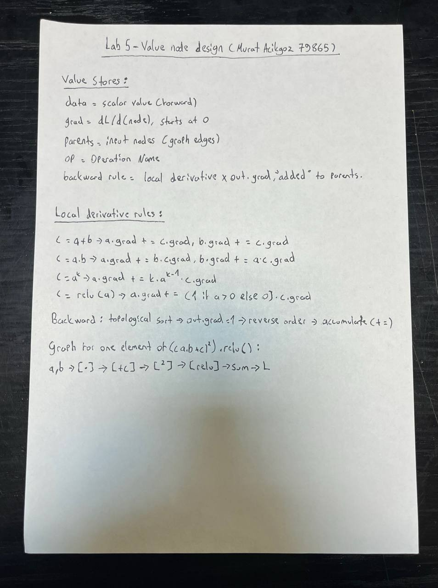
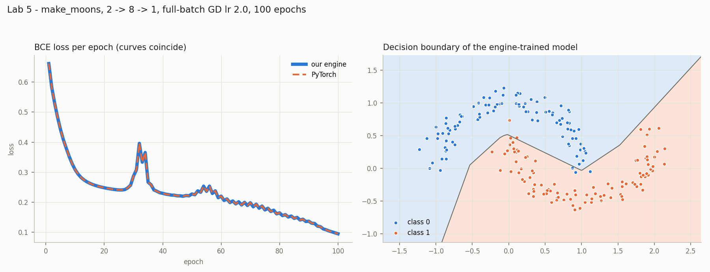
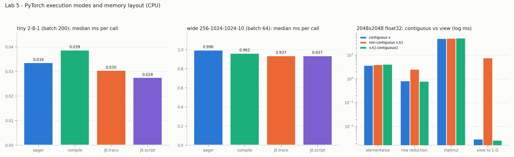

# Lab 5 - Frameworks and automatic differentiation

**Course:** Machine Learning (CYI5SE039CY), Group 11  
**Reading:** Reddi, Ch. 7 AI Frameworks - §7.3 Fundamental Concepts, §7.4 Framework Architecture, §7.6 System Integration, §§7.7-7.8

## 1. Goal

Build a scalar automatic-differentiation engine from scratch - a `Value` node, operators that record a computation graph during the forward pass, and a topological backward pass that accumulates gradients - and prove it correct against PyTorch autograd and numerical gradients. Then use it to train a small network on `make_moons`, compare its speed with PyTorch, and look inside PyTorch: its recorded graph, eager versus compiled/traced execution, and the cost of non-contiguous tensors.

## 2. Method

**Environment.** Python 3.11.8 in the pinned `.venv` (all 25 pins `OK`, `results/versions.txt`); PyTorch 2.3.1+cpu on CPU (Intel64 Family 6 Model 141 Stepping 1, GenuineIntel, 12 logical CPUs, 6 PyTorch threads, Windows 10). Seed 42 everywhere.

The engine is `src/engine.py`; every step has its own script (`verify.py`, `train_moons.py`, `torch_inspect.py`) and `src/run_all.py` runs them all and rebuilds this report.

## 3. Results

### 3.1 The Value node (step 1)

*Figure 1 - Handwritten design of the Value node, its local derivative rules and the graph of the test expression.*

| Field | Meaning |
|---|---|
| `data` | the scalar computed in the forward pass |
| `grad` | dL/d(node), starts at 0 and is filled by `backward()` |
| `_parents` | the input nodes of the operation - the edges of the graph |
| `_op` | the operation that produced the node (`+`, `*`, `**k`, `relu`, ...) |
| `_backward` | the local derivative rule: a closure that adds (local derivative x `out.grad`) to each parent's `grad` |

### 3.2 Operations build the graph (step 2)

| Operation | Forward | Local derivative rule (in `_backward`) |
|---|---|---|
| add | `c = a + b` | `a.grad += c.grad`, `b.grad += c.grad` |
| mul | `c = a * b` | `a.grad += b.data * c.grad`, `b.grad += a.data * c.grad` |
| pow | `c = a ** k` (constant k) | `a.grad += k * a.data**(k-1) * c.grad` |
| relu | `c = max(0, a)` | `a.grad += (1 if a.data > 0 else 0) * c.grad` |

Each operator returns a new `Value` whose `_parents` are its inputs, so simply evaluating an expression records the graph. For training, `exp`, `log` and `sigmoid` were added with the same pattern; subtraction and division are built from `+`, `*` and `**`.

For the test expression `((a*b + c)**2).relu().sum()` with 5-element vectors the forward pass builds **41 nodes and 40 edges**: 16 x `leaf`, 5 x `*`, 10 x `+`, 5 x `**2`, 5 x `relu` (`sum` is a chain of `+` nodes, starting from a constant 0 leaf). The topological order with every node's data and gradient is in `results/graph_test_expression.txt`, and a Graphviz version in `results/graph_test_expression.dot`.

### 3.3 Backward pass (step 3)

`backward()` (1) sorts the graph topologically with an iterative depth-first search, so every node comes after all of its parents; (2) sets the output gradient to 1; (3) visits the nodes in reverse topological order - a node's gradient is complete before its rule passes it on; (4) each rule **adds** (`+=`) to the parents' gradients instead of assigning. Accumulation matters whenever a value is used more than once:

| Test | Engine | Expected | Abs. difference | Result |
|---|---:|---:|---:|:---:|
| accumulation: y = x*x + x at x=3 | 7.000000 | 7.000000 | 0.0e+00 | PASS |
| relu negative branch: d relu(-2z)/dz at z=1.5 | 0.000000 | 0.000000 | 0.0e+00 | PASS |
| all operations (+, *, **, relu, exp, log, sigmoid, -, /) vs PyTorch | 2.560285, -4.671671, 20.708905 | 2.560285, -4.671671, 20.708905 | 4.4e-16 | PASS |

For `y = x*x + x` the node `x` receives three contributions (x, x and 1): with `=` instead of `+=` the result would be 1 or 3 instead of the correct 7.

### 3.4 Verification against PyTorch and numerical gradients (step 4)

`L = ((a*b + c)**2).relu().sum()`, a, b, c ~ N(0, 1) with 5 elements each (seed 42). Engine vs PyTorch autograd (float64) vs central differences (h = 1e-6). Loss: engine 6.4580512298, PyTorch 6.4580512298.

| Variable | Value | Engine grad | PyTorch grad | Numerical grad | Engine - PyTorch | Engine - numerical |
|---|---:|---:|---:|---:|---:|---:|
| a[0] | 0.3047 | -1.25686793 | -1.25686793 | -1.25686793 | 0.0e+00 | 5.4e-10 |
| a[1] | -1.0400 | 0.16487320 | 0.16487320 | 0.16487320 | 0.0e+00 | 3.4e-10 |
| a[2] | 0.7505 | 0.10834088 | 0.10834088 | 0.10834088 | 0.0e+00 | 1.2e-10 |
| a[3] | 0.9406 | -0.03734691 | -0.03734691 | -0.03734691 | 0.0e+00 | 9.5e-11 |
| a[4] | -1.9510 | -3.63708597 | -3.63708597 | -3.63708597 | 0.0e+00 | 3.7e-10 |
| b[0] | -1.3022 | 0.29411392 | 0.29411392 | 0.29411392 | 0.0e+00 | 1.2e-10 |
| b[1] | 0.1278 | -1.34124659 | -1.34124659 | -1.34124659 | 0.0e+00 | 1.9e-10 |
| b[2] | -0.3162 | -0.25709548 | -0.25709548 | -0.25709547 | 0.0e+00 | 5.6e-10 |
| b[3] | -0.0168 | 2.09075992 | 2.09075992 | 2.09075992 | 0.0e+00 | 8.3e-11 |
| b[4] | -0.8530 | -8.31854313 | -8.31854313 | -8.31854313 | 0.0e+00 | 2.1e-10 |
| c[0] | 0.8794 | 0.96520328 | 0.96520328 | 0.96520328 | 0.0e+00 | 1.6e-11 |
| c[1] | 0.7778 | 1.28967990 | 1.28967990 | 1.28967990 | 0.0e+00 | 2.1e-10 |
| c[2] | 0.0660 | -0.34258787 | -0.34258787 | -0.34258787 | 0.0e+00 | 2.4e-10 |
| c[3] | 1.1272 | 2.22287726 | 2.22287726 | 2.22287726 | 0.0e+00 | 2.4e-10 |
| c[4] | 0.4675 | 4.26365612 | 4.26365612 | 4.26365612 | 0.0e+00 | 6.7e-10 |

**Max absolute difference: engine vs PyTorch 0.0e+00, engine vs numerical 6.7e-10 - both below the 1e-6 limit: PASS.** The engine and PyTorch apply the same chain rule in float64, so they agree to rounding error; the numerical estimate differs by the truncation and rounding error of a finite difference.

### 3.5 Training on make_moons and speed vs PyTorch (step 5)

`make_moons(n_samples=200, noise=0.1, random_state=42)`; network 2 -> 8 (ReLU) -> 1 (sigmoid), BCE loss, 33 parameters; full-batch gradient descent, lr 2, 100 epochs, float64. Both implementations start from the same weights and use the same loss formula.

| | Our engine | PyTorch |
|---|---:|---:|
| final loss | 0.094617 | 0.094617 |
| training accuracy | 0.975 | 0.975 |
| training time, median of 5 runs (s) | 14.274 | 0.0254 |
| time per epoch (ms) | 142.74 | 0.254 |

*Figure 2 - Loss per epoch of both implementations (they lie on top of each other) and the decision boundary learned with the engine.*

The two loss curves differ by at most 2.1e-15 over all 100 epochs and the final weights by 8.9e-16 - an end-to-end confirmation of the engine beyond the single test expression. **PyTorch is 561x faster.** The engine builds a new Python object for every scalar operation - 17,436 `Value` nodes per epoch, each with its own closure - and walks them one by one in the interpreter. PyTorch records one graph node per *tensor* operation (a few per epoch) and runs each as a single vectorised C++ kernel over all 200 samples, so the interpreter overhead is paid a handful of times instead of tens of thousands of times.

### 3.6 Inside PyTorch (step 6)

**Graph inspection** of the same 2 -> 8 -> 1 model as `nn.Sequential`: walking `loss.grad_fn` gives the autograd graph recorded during one eager forward pass (12 nodes: `BinaryCrossEntropyBackward0`, `SigmoidBackward0`, `AddmmBackward0`, `ReluBackward0`, `TBackward0` and `AccumulateGrad` for each parameter - `results/torch_autograd_graph.txt`). It is the tensor-level equivalent of our Value graph. `torch.fx.symbolic_trace` gives a static graph of 6 nodes (`results/torch_fx_graph.txt`) and `torch.jit.trace` a TorchScript graph (`results/torch_jit_graph.txt`) - the graph is captured once and can be optimised instead of being rebuilt on every call.

**Compilation support on this machine:**

| Model | torch.compile | torch.jit.trace | torch.jit.script |
|---|---|---|---|
| tiny 2-8-1 (batch 200) | ok | ok | ok |
| wide 256-1024-1024-10 (batch 64) | ok | ok | ok |

**Eager vs compiled/traced** (inference, `torch.no_grad()`, 10 warm-up calls, median of 100 calls):

| Model | Variant | Median ms | Speed-up vs eager | Max output difference |
|---|---|---:|---:|---:|
| tiny 2-8-1 (batch 200) | eager | 0.0336 | 1.00x | 0.00e+00 |
| tiny 2-8-1 (batch 200) | torch.compile | 0.0387 | 0.87x | 0.00e+00 |
| tiny 2-8-1 (batch 200) | torch.jit.trace | 0.0305 | 1.10x | 0.00e+00 |
| tiny 2-8-1 (batch 200) | torch.jit.script | 0.0276 | 1.22x | 0.00e+00 |
| wide 256-1024-1024-10 (batch 64) | eager | 0.9961 | 1.00x | 0.00e+00 |
| wide 256-1024-1024-10 (batch 64) | torch.compile | 0.9620 | 1.03x | 0.00e+00 |
| wide 256-1024-1024-10 (batch 64) | torch.jit.trace | 0.9366 | 1.06x | 0.00e+00 |
| wide 256-1024-1024-10 (batch 64) | torch.jit.script | 0.9368 | 1.06x | 0.00e+00 |

*Figure 3 - Eager vs compiled/traced execution for both models, and operations on a contiguous tensor, its transposed view and a contiguous copy (log scale).*

**Tensor shape, dtype and contiguity** (`results/tensor_layout.csv`):

| Tensor | Shape | dtype | Stride | Contiguous | Shares storage with x |
|---|---|---|---|:---:|:---:|
| `x = arange(24).reshape(4, 6)` | (4, 6) | float32 | (6, 1) | True | True |
| `x.t()  (transpose view)` | (6, 4) | float32 | (1, 6) | False | True |
| `x[:, ::2]  (strided slice)` | (4, 3) | float32 | (6, 2) | False | True |
| `x[1:3]  (row slice)` | (2, 6) | float32 | (6, 1) | True | True |
| `x.unsqueeze(0).expand(3, 4, 6)` | (3, 4, 6) | float32 | (0, 6, 1) | False | True |
| `x.t().contiguous()  (copy)` | (6, 4) | float32 | (4, 1) | True | False |
| `x.half()  (new dtype)` | (4, 6) | float16 | (6, 1) | True | False |

A view (transpose, slice, expand) only changes the **strides** - how many elements to skip per index step - and shares the original storage; `expand` even uses stride 0. `contiguous()` and a new dtype allocate new storage.

**Cost of a non-contiguous view** - 2048 x 2048 float32, median of 20 runs (ms):

| Operation | contiguous x | non-contiguous x.t() | x.t().contiguous() | strided x[:, ::2] | x[:, ::2].contiguous() |
|---|---:|---:|---:|---:|---:|
| elementwise  y = v * 2 + 1 | 3.744 | 3.935 | 4.147 | 2.819 | 2.304 |
| row reduction  v.sum(dim=1) | 0.834 | 2.553 | 0.806 | 0.538 | 0.319 |
| matmul  v @ w | 49.779 | 51.174 | 51.984 | 27.847 | 26.776 |
| view to 1-D  v.reshape(-1) | 0.003 | 7.652 | 0.003 | 0.003 | 0.003 |

Cost of making the copy itself: x.t().contiguous() 6.823 ms; x[:, ::2].contiguous() 1.130 ms.

On the transposed view the element-wise op is about the same, the row reduction 3.1x slower and the matmul about the same than on the contiguous tensor; `reshape(-1)` is 2550.6x slower. Where it is slower (row reduction) the cause is memory access: in the contiguous tensor consecutive elements of a row are neighbours in memory, so the CPU reads whole cache lines and uses vector instructions, while on the transposed view the same loop jumps 2048 floats (8 KB) between elements and wastes most of every cache line. Where it is not (element-wise op, matmul) PyTorch avoids the strided loop: element-wise kernels iterate in memory order whatever the logical shape, and BLAS receives a transpose as a flag and picks a matching kernel. `reshape(-1)` is a free view on a contiguous tensor but must copy the whole array when the strides do not allow a view - the clearest cost of non-contiguity. When a non-contiguous tensor is used repeatedly, paying once for `.contiguous()` and reusing the copy avoids paying on every operation.

### 3.7 Note: when does compilation help?

Measured: tiny 2-8-1 (batch 200): best torch.jit.script 1.22x vs eager (0.0336 -> 0.0276 ms); wide 256-1024-1024-10 (batch 64): best torch.jit.trace 1.06x vs eager (0.9961 -> 0.9366 ms). Compilation (or tracing) removes per-call Python and dispatcher overhead and can fuse small operations into fewer kernels. It therefore helps most when that overhead is a large share of the run time - small models, small batches, many cheap element-wise ops - and when the same graph is run many times, so the one-off compile cost is amortised. It helps little when the time is dominated by large matrix multiplications, which already run in optimised BLAS kernels in eager mode either way. `torch.compile` itself did not pay off here: tiny 2-8-1 (batch 200) 0.87x, wide 256-1024-1024-10 (batch 64) 1.04x. For the tiny model every call is only a few hundredths of a millisecond, so the guard checks and the hand-off into the compiled graph cost about as much as the work itself; for the wide model the time is spent in large matrix multiplications that the compiler passes to the same BLAS library as eager mode. TorchScript (trace/script) has a lighter call path and gave the larger gain on the tiny model. This run shows exactly that: the overhead-bound tiny model gains more (1.22x) than the matmul-bound wide model (1.06x). It is not worth it for code that changes shape or control flow on every call (re-compilation), for one-off scripts, or while debugging, where eager mode's immediate execution is what you want.

## 4. Conclusions

1. **A correct autograd needs only three ideas:** record parents and a local derivative rule in every node, sort topologically, and accumulate. With them the engine matches PyTorch exactly (difference 0) and numerical gradients to 7e-10 on the test expression, and reproduces PyTorch's whole training run to 2e-15.

2. **Granularity decides speed.** The same mathematics is 561x slower with scalar nodes (17,436 Python objects per epoch) than with tensor operations: frameworks win by making each graph node do a lot of work in compiled code.

3. **Execution mode and memory layout are system costs too.** Capturing the graph (tracing/compiling) gave a 1.22x speed-up for the tiny model and 1.06x for the wide one, and on a transposed view the row reduction was 3.1x slower while `reshape(-1)` turned from a free view into a full copy - the same values, a different memory layout.

## 5. Reproducibility

With the virtual environment active, run `python lab05/src/run_all.py` from the repository root. It regenerates every file in `lab05/results/` and this report (the photo of the handwritten page is kept). Seeds are fixed to 42; timings depend on the machine and its load.
