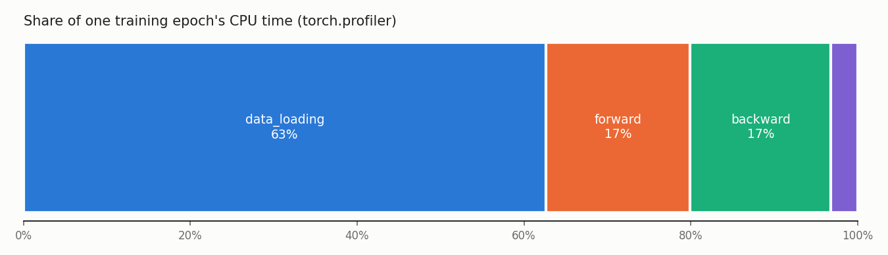
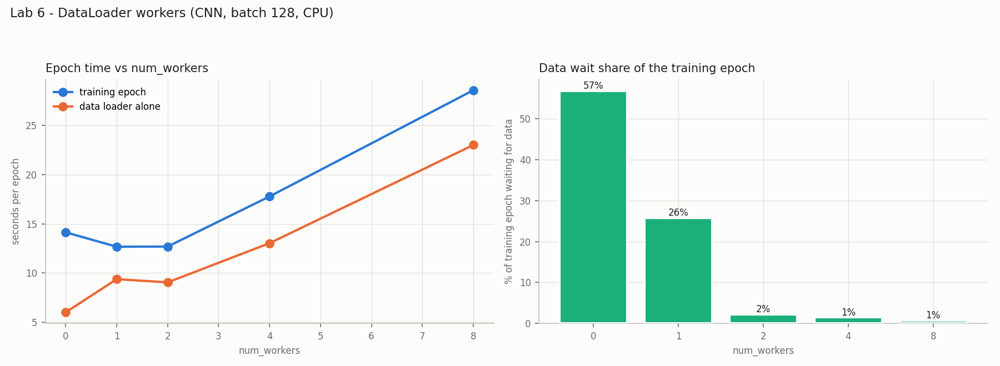
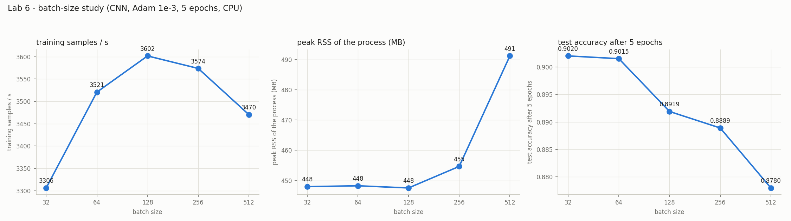
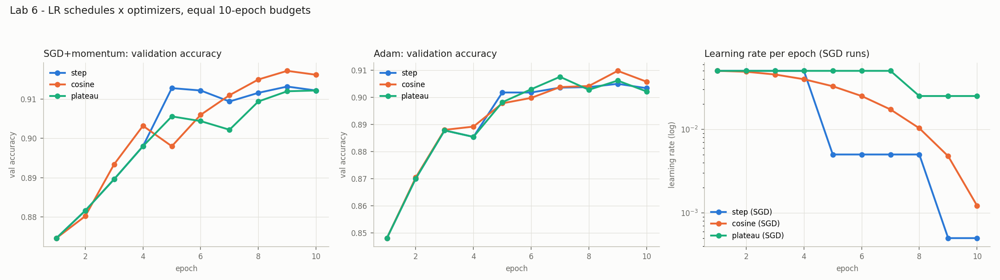
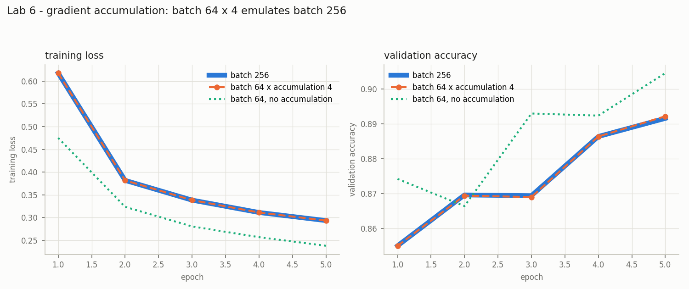
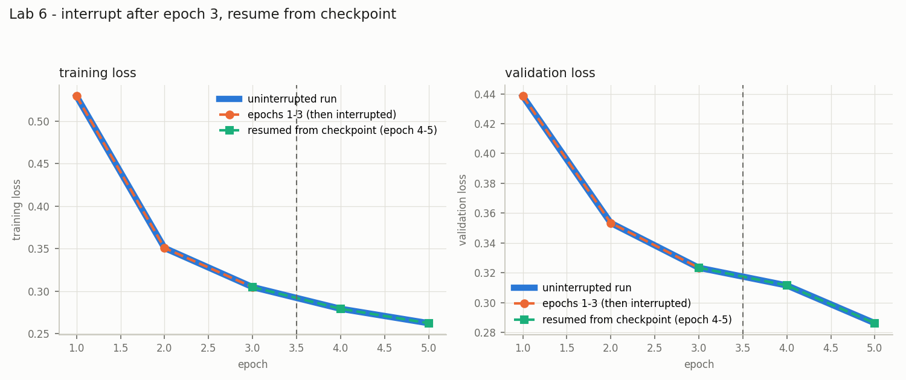
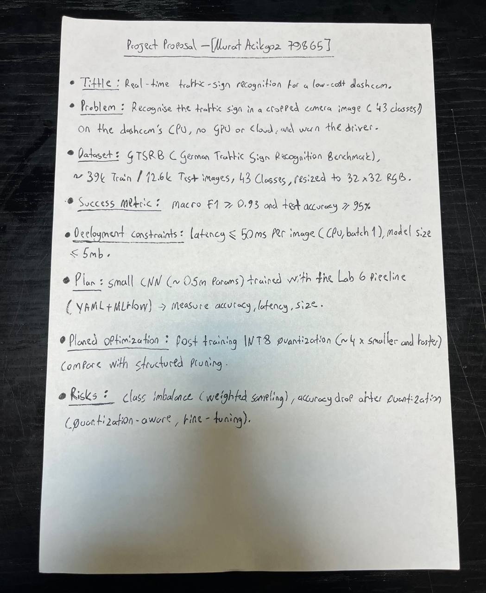

# Lab 6 - Training pipelines and project proposal

**Course:** Machine Learning (CYI5SE039CY), Group 11  
**Reading:** Reddi, Ch. 8 AI Training (training-system architecture, data loading, optimization, profiling, §8.7 Optimization Techniques); Ch. 5 §5.5 Model Development; Ch. 13 §13.3 MLOps Key Components

## 1. Goal

Turn the best Lab 3 model (the CNN on Fashion-MNIST) into a reproducible training pipeline driven by one YAML config, with seeding, checkpoints and MLflow tracking; use it to profile an epoch and to study DataLoader workers, batch size, learning-rate schedules and optimizers, gradient accumulation and interrupt/resume; and write the individual project proposal.

## 2. Pipeline

**Environment.** Python 3.11.8 in the pinned `.venv` (all 25 pins `OK`, `results/versions.txt`); PyTorch 2.3.1+cpu, MLflow 2.14.1, CPU only (Intel64 Family 6 Model 141 Stepping 1, GenuineIntel, 12 logical CPUs, 6 PyTorch threads, Windows 10).

| Component | Implementation |
|---|---|
| One config object | `configs/base.yaml` - seed, data, model, optimizer, scheduler, gradient accumulation, checkpointing, MLflow; every study only overrides keys (`train.py --set data.batch_size=256`) |
| Training script | `src/train.py` - builds everything from the config; one function `run(cfg)` |
| Seed | `random`, `numpy`, `torch` = 42; the DataLoader shuffles with its own seeded generator |
| Checkpoint | after every epoch: model, optimizer, scheduler, epoch, history, all RNG states, DataLoader generator state, MLflow run id |
| MLflow | local store `lab06/mlflow_runs/`; params = flattened config, metrics per epoch (loss, accuracy, lr, epoch time, throughput, data wait), artifacts = config, history CSV, checkpoint |
| Studies | `profile_epoch.py`, `workers_study.py`, `studies.py` (batch, schedules, accum, resume) - each training run in its own process for clean memory numbers |

## 3. Results

### 3.1 Step 1 - the YAML-driven base run

Base config: CNN (20,490 parameters), Adam lr 0.001, batch 128, 5 epochs, seed 42, 55k/5k/10k split.

| Epoch | Train loss | Train acc | Val loss | Val acc | Epoch time (s) | Samples/s |
|---:|---:|---:|---:|---:|---:|---:|
| 1 | 0.5295 | 0.8132 | 0.4384 | 0.8480 | 14.3 | 3848 |
| 2 | 0.3509 | 0.8754 | 0.3534 | 0.8700 | 14.4 | 3824 |
| 3 | 0.3049 | 0.8905 | 0.3234 | 0.8878 | 14.4 | 3829 |
| 4 | 0.2794 | 0.9005 | 0.3115 | 0.8854 | 14.4 | 3811 |
| 5 | 0.2625 | 0.9055 | 0.2862 | 0.8982 | 14.3 | 3839 |

**Test accuracy 0.8919** - identical to the Lab 3 CNN (0.8919): same seed, same split, same model, so the restructured pipeline reproduces the earlier result exactly. MLflow run `617521f762364291a1585df5f26ca9da` in experiment `lab06-base`; peak memory 449 MB.

### 3.2 Step 2 - profile of one epoch

`torch.profiler` over one full epoch (430 steps) after a warm-up epoch; each phase wrapped in `record_function`. Wall-clock timers around the same regions as a cross-check.

| Phase | Profiler CPU time (ms) | Share | Wall-clock (ms) | Share |
|---|---:|---:|---:|---:|
| data_loading | 11,702 | **62.6%** | 11,706 | 62.5% |
| forward | 3,230 | **17.3%** | 3,243 | 17.3% |
| backward | 3,154 | **16.9%** | 3,168 | 16.9% |
| optimizer_step | 595 | **3.2%** | 606 | 3.2% |

The largest share is **data_loading (63%)**; forward + backward together take 34% of the epoch, optimizer step 3%. With a 20k-parameter model Adam's update is cheap. Top operators: `results/profile_table.txt`.

### 3.3 Step 3 - num_workers

| num_workers | Loader alone (s/epoch) | Time to first batch (s) | Training epoch (s) | Samples/s | Data wait | Data-wait share |
|---:|---:|---:|---:|---:|---:|---:|
| 0 | 5.98 | 0.04 | 14.13 | 3,894 | 8.04 s | 57% |
| 1 | 9.36 | 2.77 | 12.67 | 4,343 | 3.27 s | 26% |
| 2 | 9.03 | 5.39 | 12.68 | 4,339 | 0.29 s | 2% |
| 4 | 13.02 | 10.49 | 17.78 | 3,093 | 0.26 s | 1% |
| 8 | 23.02 | 20.85 | 28.59 | 1,923 | 0.21 s | 1% |

**With `num_workers=0` data loading is a real bottleneck** (57% of the epoch is spent waiting for batches). The fastest setting is `num_workers=1` (12.7 s, 1.12x vs 0 workers); the slowest is `num_workers=8` (28.6 s). Extra worker processes move loading off the main process, but each one must start a Python interpreter (see time to first batch; on Windows workers are spawned, not forked) and they compete with PyTorch's compute threads for the same CPU cores, so beyond the point where the data wait is gone more workers only add overhead.

### 3.4 Step 4 - batch size

Adam lr 1e-3 for every batch size (no learning-rate scaling), 5 epochs, each run in a fresh process.

| Batch | Optimizer steps / epoch | Throughput (samples/s) | Peak RSS (MB) | Peak - baseline (MB) | Final val acc | **Test acc after 5 epochs** |
|---:|---:|---:|---:|---:|---:|---:|
| 32 | 1719 | 3,306 | 448 | 72 | 0.9006 | **0.9020** |
| 64 | 860 | 3,521 | 448 | 72 | 0.9046 | **0.9015** |
| 128 | 430 | 3,602 | 448 | 71 | 0.8982 | **0.8919** |
| 256 | 215 | 3,574 | 455 | 78 | 0.8916 | **0.8889** |
| 512 | 108 | 3,470 | 491 | 115 | 0.8820 | **0.8780** |

Throughput rises from 3,306 samples/s at batch 32 to a peak of 3,602 at batch 128 (+9%) and then falls slightly to 3,470 at batch 512: larger batches amortise the per-step Python and kernel-launch overhead, but once that overhead is small the gain stops - most likely because the bigger activation tensors use the CPU caches less well. On this small model the total effect of batch size on speed is modest. Peak memory grows with the batch (448 -> 491 MB) because activations for the whole batch are kept for the backward pass. Accuracy after a fixed 5 epochs moves the other way: best at batch 32 (0.9020), 0.8780 at batch 512 - with the same learning rate a large batch takes far fewer optimizer steps (1719 vs 108 per epoch), so it has learned less after the same number of epochs. Large batches buy speed per sample, not accuracy per epoch, unless the learning rate is scaled up.

### 3.5 Step 5 - learning-rate schedules and optimizers (10 epochs each)

| Optimizer | Scheduler | Final LR | Best val acc | Final val acc | Final train loss | **Test acc** | Time (s) |
|---|---|---:|---:|---:|---:|---:|---:|
| SGD+momentum 0.9, lr 0.05 | StepLR(4, 0.1) | 5.00e-04 | 0.9132 | 0.9122 | 0.1768 | **0.9115** | 146 |
| SGD+momentum 0.9, lr 0.05 | CosineAnnealingLR(T_max=10) | 1.22e-03 | 0.9172 | 0.9162 | 0.1568 | **0.9140** | 144 |
| SGD+momentum 0.9, lr 0.05 | ReduceLROnPlateau(0.5, patience 1) | 2.50e-02 | 0.9122 | 0.9122 | 0.1746 | **0.9067** | 149 |
| Adam, lr 0.001 | StepLR(4, 0.1) | 1.00e-05 | 0.9050 | 0.9034 | 0.2307 | **0.8991** | 151 |
| Adam, lr 0.001 | CosineAnnealingLR(T_max=10) | 2.00e-05 | 0.9098 | 0.9058 | 0.2139 | **0.9016** | 153 |
| Adam, lr 0.001 | ReduceLROnPlateau(0.5, patience 1) | 1.00e-03 | 0.9076 | 0.9022 | 0.2079 | **0.8966** | 156 |

Best combination: **SGD+momentum 0.9, lr 0.05 with CosineAnnealingLR(T_max=10) - test accuracy 0.9140**. Averaged over the three schedules, SGD+momentum is ahead (Adam 0.8991, SGD+momentum 0.9107) under the same 10-epoch budget, and the best schedule on average is CosineAnnealingLR(T_max=10). StepLR cuts the learning rate by 10x at epochs 4 and 8, which first speeds up convergence but leaves only a tiny step size for the last epochs; cosine annealing decays smoothly to zero, so the final epochs fine-tune; ReduceLROnPlateau only reacts when the validation loss stops improving, so its learning rate stays high as long as progress continues. Adam adapts the step per parameter and is less sensitive to the choice of learning rate; SGD+momentum needs the schedule to do more of the work.

### 3.6 Step 6 - gradient accumulation

Batch 64 with 4 accumulation steps emulates batch 256: gradients of four micro-batches are summed (each loss weighted by its share of the 256 samples) and the optimizer steps once. The shuffled order is the same, so the four micro-batches contain exactly the samples of one batch-256 step.

| Epoch | Train loss b256 | Train loss b64x4 | Train loss b64 (no accum) | Val acc b256 | Val acc b64x4 | Val acc b64 | Opt. steps b256 / b64x4 / b64 |
|---:|---:|---:|---:|---:|---:|---:|---|
| 1 | 0.61751 | 0.61750 | 0.47520 | 0.8550 | 0.8550 | 0.8742 | 215 / 215 / 860 |
| 2 | 0.38190 | 0.38186 | 0.32376 | 0.8696 | 0.8694 | 0.8664 | 215 / 215 / 860 |
| 3 | 0.33854 | 0.33853 | 0.28077 | 0.8694 | 0.8690 | 0.8930 | 215 / 215 / 860 |
| 4 | 0.31138 | 0.31137 | 0.25718 | 0.8864 | 0.8864 | 0.8924 | 215 / 215 / 860 |
| 5 | 0.29363 | 0.29363 | 0.23825 | 0.8916 | 0.8922 | 0.9046 | 215 / 215 / 860 |

**Batch 64 x 4 tracks batch 256 almost exactly** - largest difference in training loss 4.0e-05, in validation accuracy 0.0006; test accuracy 0.8889 vs 0.8886. The remaining differences come only from floating-point summation order. The same micro-batch without accumulation (batch 64, 4x more optimizer steps) follows a different curve (test 0.9015), which shows that the match is due to accumulation and not to the micro-batch size. Peak memory: batch 256 454 MB vs batch 64x4 449 MB - accumulation reaches the large-batch update with small-batch activation memory, at lower throughput.

### 3.7 Step 7 - interrupt at epoch 3, resume from checkpoint

| Epoch | Segment | Train loss uninterrupted | Train loss interrupted + resumed | Val loss uninterrupted | Val loss resumed | Abs. diff (train / val) |
|---:|---|---:|---:|---:|---:|---|
| 1 | before interruption | 0.529490 | 0.529490 | 0.438430 | 0.438430 | 0.0e+00 / 0.0e+00 |
| 2 | before interruption | 0.350890 | 0.350890 | 0.353390 | 0.353390 | 0.0e+00 / 0.0e+00 |
| 3 | before interruption | 0.304950 | 0.304950 | 0.323350 | 0.323350 | 0.0e+00 / 0.0e+00 |
| 4 | after resume | 0.279390 | 0.279390 | 0.311510 | 0.311510 | 0.0e+00 / 0.0e+00 |
| 5 | after resume | 0.262480 | 0.262480 | 0.286190 | 0.286190 | 0.0e+00 / 0.0e+00 |

The run was stopped after epoch 3 (checkpoint saved) and restarted from that checkpoint as a new process. **The curves continue seamlessly: epochs 4-5 match the uninterrupted run to 0.0e+00**, and the test accuracy is 0.8919 vs 0.8919. This works because the checkpoint stores not only the weights but the optimizer state (Adam's moment estimates), the scheduler, the epoch counter and every random-number state including the DataLoader's shuffling generator. The resumed process also continued the same MLflow run, so the run's metric history is one unbroken curve.

### 3.8 MLflow runs

**22 runs in 7 experiments** are stored in `lab06/mlflow_runs/` (params, per-epoch metrics, artifacts); browse them with `mlflow ui --backend-store-uri lab06/mlflow_runs`. Full export: `results/mlflow_runs.csv`.

| Experiment | Runs |
|---|---:|
| lab06-base | 1 |
| lab06-batch-size | 5 |
| lab06-grad-accum | 3 |
| lab06-num-workers | 5 |
| lab06-profile | 1 |
| lab06-resume | 1 |
| lab06-schedules | 6 |

| Experiment | Run | Status | batch | workers | optimizer | lr | scheduler | accum | test acc |
|---|---|---|---:|---:|---|---:|---|---:|---:|
| lab06-base | base-cnn-adam | FINISHED | 128 | 0 | adam | 0.001 | none | 1 | 0.8919 |
| lab06-batch-size | bs-128 | FINISHED | 128 | 0 | adam | 0.001 | none | 1 | 0.8919 |
| lab06-batch-size | bs-256 | FINISHED | 256 | 0 | adam | 0.001 | none | 1 | 0.8889 |
| lab06-batch-size | bs-32 | FINISHED | 32 | 0 | adam | 0.001 | none | 1 | 0.9020 |
| lab06-batch-size | bs-512 | FINISHED | 512 | 0 | adam | 0.001 | none | 1 | 0.8780 |
| lab06-batch-size | bs-64 | FINISHED | 64 | 0 | adam | 0.001 | none | 1 | 0.9015 |
| lab06-grad-accum | accum-bs256 | FINISHED | 256 | 0 | adam | 0.001 | none | 1 | 0.8889 |
| lab06-grad-accum | accum-bs64-no-accum | FINISHED | 64 | 0 | adam | 0.001 | none | 1 | 0.9015 |
| lab06-grad-accum | accum-bs64x4 | FINISHED | 64 | 0 | adam | 0.001 | none | 4 | 0.8886 |
| lab06-num-workers | workers-0 | FINISHED | 128 | 0 | adam | 0.001 | none | 1 | - |
| lab06-num-workers | workers-1 | FINISHED | 128 | 1 | adam | 0.001 | none | 1 | - |
| lab06-num-workers | workers-2 | FINISHED | 128 | 2 | adam | 0.001 | none | 1 | - |
| lab06-num-workers | workers-4 | FINISHED | 128 | 4 | adam | 0.001 | none | 1 | - |
| lab06-num-workers | workers-8 | FINISHED | 128 | 8 | adam | 0.001 | none | 1 | - |
| lab06-profile | profile-one-epoch | FINISHED | 128 | 0 | adam | 0.001 | none | 1 | - |
| lab06-resume | resume-test | FINISHED | 128 | 0 | adam | 0.001 | none | 1 | 0.8919 |
| lab06-schedules | adam-cosine | FINISHED | 128 | 0 | adam | 0.001 | cosine | 1 | 0.9016 |
| lab06-schedules | adam-plateau | FINISHED | 128 | 0 | adam | 0.001 | plateau | 1 | 0.8966 |
| lab06-schedules | adam-step | FINISHED | 128 | 0 | adam | 0.001 | step | 1 | 0.8991 |
| lab06-schedules | sgd-cosine | FINISHED | 128 | 0 | sgd | 0.05 | cosine | 1 | 0.9140 |
| lab06-schedules | sgd-plateau | FINISHED | 128 | 0 | sgd | 0.05 | plateau | 1 | 0.9067 |
| lab06-schedules | sgd-step | FINISHED | 128 | 0 | sgd | 0.05 | step | 1 | 0.9115 |

### 3.9 Step 8 - individual project proposal

The one-page proposal (problem, dataset, success metric, deployment constraints latency <= 50 ms and size <= 5 MB, planned optimization, name and ID) is in [`proposal.md`](proposal.md) and as the signed handwritten page below.

## 4. Conclusions

1. **One config object makes every experiment a small, reproducible diff.** All 22 runs come from `base.yaml` plus a few overrides, are fully logged in MLflow, and the base run reproduces the Lab 3 accuracy exactly; checkpoints restore training exactly.

2. **Data loading is a significant cost on this CPU.** Data loading is the largest share of an epoch (63%); the best DataLoader setting (num_workers=1) was 1.12x the speed of num_workers=0, while the best batch size (batch 128) raised throughput only +9% over batch 32 and larger batches cost memory.

3. **Optimizer and schedule matter more than raw speed for the final result.** Under the same 10-epoch budget the best combination (SGD+momentum 0.9 + CosineAnnealingLR) reached 0.9140; gradient accumulation reproduces a large-batch update with small-batch memory.

## 5. Reproducibility

With the virtual environment active, run `python lab06/src/run_all.py` from the repository root (about 30 minutes on a laptop CPU). It regenerates `lab06/results/`, the MLflow store `lab06/mlflow_runs/` and this report. A single run: `python lab06/src/train.py --config lab06/configs/base.yaml --set epochs=10 scheduler.name=cosine`.
